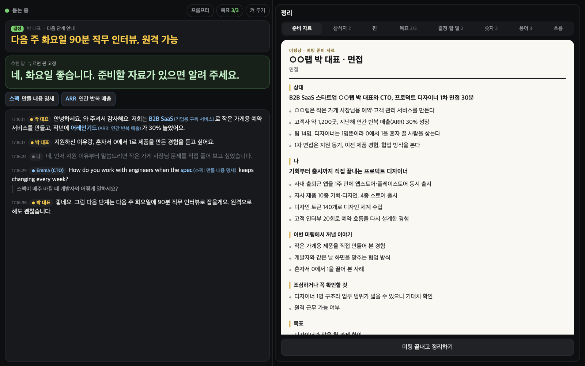
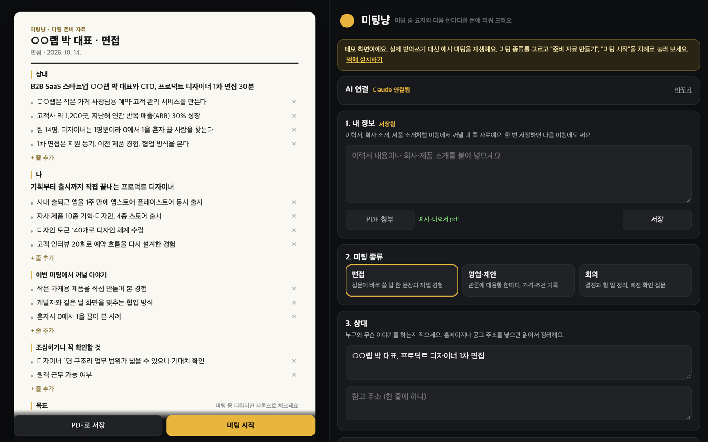
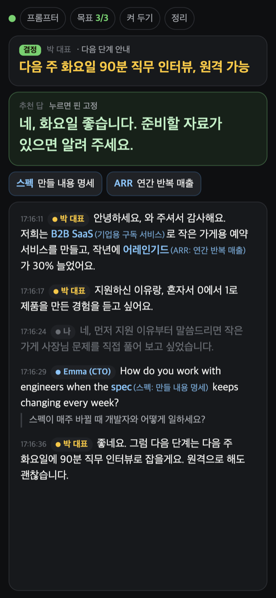
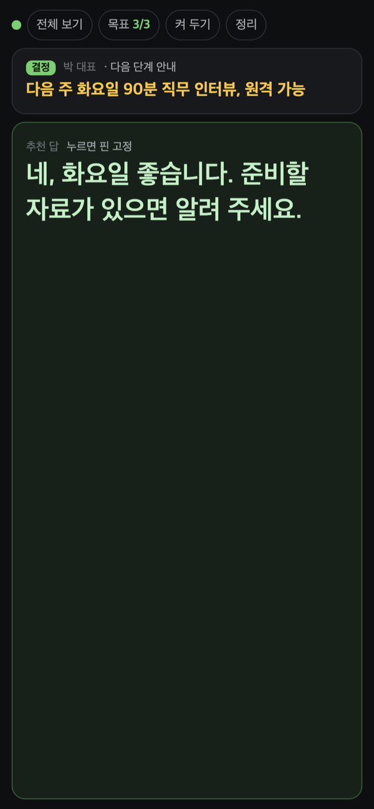
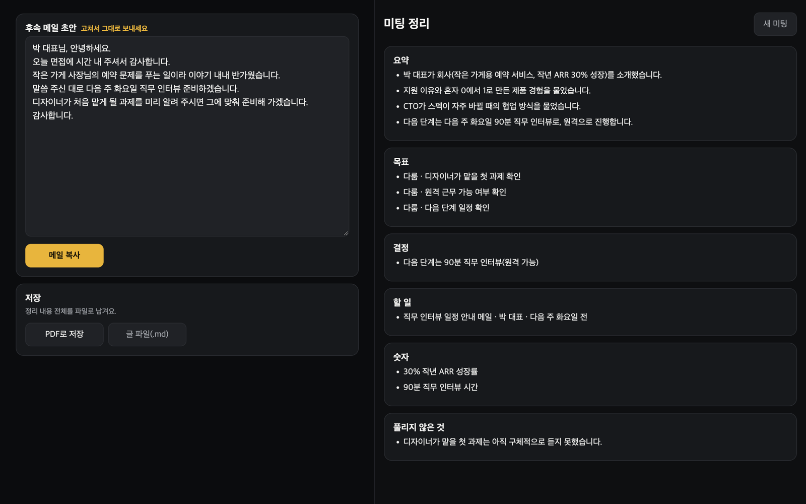

<p align="center"></p>

# 미팅냥 (meeting-meo)

[Define404]

화상 미팅에서 상대가 방금 한 말의 요지, 내가 바로 할 다음 한마디, 모르는 용어 풀이를 맥 화면과 폰에 띄워 드려요. 미팅이 끝나면 결정, 할 일, 후속 메일 초안까지 정리해 드려요.

**설치 없이 눌러 보기**: https://meeting.define404.com (예시 미팅을 재생하는 데모예요)

**새 소식 (2026-10-21)**: 미팅을 일찍 켜 둬도 화상 통화가 시작될 때부터 받아써요. [업데이트 내역](#업데이트-내역)

- 면접, 영업·제안, 회의에 맞춰 다음 한마디를 다르게 드려요
- 여러 명이 말해도 목소리로 사람을 나누고, 다른 언어로 말하면 줄마다 한국어로 옮겨요
- 받아쓰기는 맥 안에서만 돌아요. 소리는 밖으로 나가지 않아요
- 요약 AI는 Claude, ChatGPT, Gemini 중에서 골라 본인 키로 써요
- 오픈소스(MIT)라 누구나 무료로 쓰고 고칠 수 있어요



## 이런 때 써요

| 상황 | 미팅냥이 하는 일 |
|---|---|
| 면접 | 질문 요지를 한 줄로 잡고, 내 이력에서 꺼낼 경험과 답 한 문장을 띄워요. 자료에 없는 경험은 지어내지 않고 ○○로 비워 둬요 |
| 영업·제안 | 손님의 걱정과 반론에 대응할 한마디를 주고, 가격·조건 숫자를 모아요. 미리 정한 최저 가격 아래로 이야기가 흐르면 알려 드려요 |
| 회의 | 결정과 할 일(누가, 무엇을, 언제까지)을 실시간으로 뽑고, 담당자나 기한이 빠지면 확인 질문을 드려요 |

## 화면

### 1. 미팅 전: 준비 자료

내 이력서나 회사 소개, 상대 회사 홈페이지 주소, 이번 미팅 목표를 넣으면 한 장짜리 준비 자료를 만들어 드려요. 줄을 눌러 고치고, PDF로 저장할 수 있어요.



### 2. 미팅 중: 맥과 폰

| 맥 | 폰 (전체 보기) | 폰 (프롬프터) |
|---|---|---|
| 왼쪽은 요지·다음 한마디·받아쓴 글, 오른쪽은 준비 자료와 정리 칸이에요 | 맥 화면의 QR 코드를 찍으면 같은 미팅이 폰에 열려요 | 추천 답만 크게 띄워요. 카메라 옆에 세워 두고 보기 좋아요 |
|  |  |  |

- 받아쓴 문장, 요지, 추천 답, 용어를 누르면 핀으로 고정돼요. 맥과 폰의 핀이 서로 맞춰져요.
- 처음 나온 전문용어(IT, 개발, 회계, 비즈니스)는 받아쓴 글 옆에 괄호로 뜻을 달아 드려요.
- 준비할 때 적은 목표가 대화에 나오면 자동으로 체크하고, 시간이 얼마 안 남았는데 못 다룬 목표가 있으면 알려 드려요.
- 상대 이름표를 누르면 "상대 1"을 실제 이름으로 바꿀 수 있어요. 바꾼 이름은 요약에도 쓰여요.

### 3. 미팅 후: 정리



요약, 목표를 다뤘는지, 결정, 할 일, 숫자, 풀리지 않은 것, 핀 고정한 것, 후속 메일 초안을 보여 드려요. PDF나 글 파일로 저장할 수 있어요.

## 필요한 것

- macOS 15 이상 맥 (애플 실리콘 권장)
- [Homebrew](https://brew.sh)
- Xcode 명령줄 도구 (`xcode-select --install`)
- AI 키 하나: [Claude](https://platform.claude.com/), [ChatGPT](https://platform.openai.com/api-keys), [Gemini](https://aistudio.google.com/apikey) 중 하나. Gemini는 무료로 시작할 수 있어요
- 폰으로 볼 때는 맥과 같은 와이파이

## 설치

```bash
git clone https://github.com/johndefine404/meeting-meo.git
cd meeting-meo
./install.sh
```

설치 스크립트가 받아쓰기 엔진(whisper-cpp)을 깔고, 소리 받기 프로그램과 PDF 프로그램을 만들고, 파이썬 환경을 준비하고, 미팅냥 앱을 만들어요.

## 쓰는 법

설치하면 `~/Applications`에 **미팅냥** 앱이 생겨요. 독에 끌어다 두고 누르기만 하면 돼요. 이미 켜져 있으면 화면만 다시 열어요.

터미널에서 켜도 돼요.

```bash
./meeting-meo
```

1. 맥 브라우저에 준비 화면이 열려요. 처음이면 맨 위 "AI 연결"에서 AI를 고르고 키를 넣어 주세요.
2. 내 정보, 미팅 종류, 상대, 목표를 넣고 "준비 자료 만들기"를 눌러요. 20~40초 걸려요.
3. 자료를 훑어보고 "미팅 시작"을 눌러요.
4. 폰으로 보려면 위쪽 "폰 연결"의 QR 코드를 찍고, "켜 두기"를 눌러 화면이 꺼지지 않게 해요.
5. 끝나면 "미팅 끝내고 정리하기"를 눌러요.

처음 실행할 때 받아쓰기 모델(약 570MB)과 화자 구분 모델(약 28MB)을 한 번 내려받아요. 미팅을 처음 시작하면 맥이 화면 기록과 마이크 권한을 물어봐요(미팅냥 앱으로 켰다면 '미팅냥'에 허용해 주세요). 둘 다 허용해 주세요. 화면 기록 권한은 통화 소리(상대 목소리)를 받는 데만 써요.

### 구글 미트와 줌

- **구글 미트**: 미팅냥으로 돌아오면 구글 미트가 마이크·카메라 버튼이 있는 작은 창을 스스로 띄워요. 그 작은 창을 미팅냥 위 편한 자리에 두고 쓰면 돼요.
- **줌 앱**: "미팅 시작" 위의 "회의 화면도 미팅냥 안에 비추기"를 켜면 줌 창을 미팅냥 왼쪽에 크게 비춰 드려요. 보기 전용이라 조작은 줌 창에서 해요.
- 에어팟으로 들어도 상대 소리는 잘 잡혀요. 맥이 소리를 내보내기 전에 받거든요.
- 언어가 섞인 미팅이면 준비 화면 6번에서 "섞여 있음 (자동)"을 고르세요.

## 지켜 주세요

- 미팅냥은 상대 목소리를 받아 적어요. 미팅을 시작하기 전에 상대에게 받아쓰기 도구를 쓴다고 알려 주세요.
- 추천 답은 참고용이에요. 그대로 읽기보다 내 말로 바꿔 말하는 편이 자연스러워요.

## 내 정보는 어디로 가나요

| 정보 | 가는 곳 |
|---|---|
| 소리 | 맥 안에서만 받아쓰고 버려요. 녹음 파일을 남기지 않아요 |
| 받아쓴 글, 내 정보, 준비 자료 | 요약할 때만 본인이 고른 AI 회사로 보내요 |
| AI 키, 미팅 기록 | `~/Library/Application Support/meeting-meo/` 에만 저장해요 |
| 폰 화면 | 같은 와이파이 안에서만 열려요. 주소에 열쇠가 붙어 있어 다른 사람은 들어올 수 없어요 |

Gemini 무료분은 입력 내용이 구글 서비스 개선에 쓰일 수 있어요. 민감한 미팅이면 유료 키를 쓰세요.

## 쓰는 AI 모델

| AI | 미팅 중 요약 | 미팅 전 준비·미팅 후 정리 |
|---|---|---|
| Claude | claude-sonnet-5-5 | claude-opus-5-5 |
| ChatGPT | gpt-6.1-sol | gpt-6.1-sol |
| Gemini | gemini-3.8-flash | gemini-3.8-flash |

모델은 환경 변수 `MEETING_MEO_LIVE_MODEL`, `MEETING_MEO_DEEP_MODEL`로 바꿀 수 있어요. 키를 환경 변수(`ANTHROPIC_API_KEY`, `OPENAI_API_KEY`, `GEMINI_API_KEY`)로 넣어도 돼요.

## 구성

| 경로 | 내용 |
|---|---|
| `mac/tap/main.swift` | 시스템 소리(상대)와 마이크(나)를 따로 받는 작은 프로그램 |
| `mac/pdf/main.swift` | 준비 자료와 정리를 A4 PDF로 그리는 작은 프로그램 |
| `server/meeting_meo.py` | 받아쓰기, 화자 구분, 번역, 요약, 웹 서버 |
| `web/index.html` | 준비·미팅·미팅 후 화면 (맥과 폰 공용) |
| `demo/` | 서버 없이 예시 미팅을 재생하는 데모. `python3 tools/build_demo.py`로 `demo/dist`를 만들어 올려요 |
| `tools/make_logo_lottie.py` | 로고 애니메이션 생성기 |
| `tools/make_app.sh` | 원클릭 실행용 미팅냥 앱 만들기 |

### 면접 준비, 연습, 기록장

면접을 고르고 준비 자료를 만들면 아래에 면접 준비 키트가 붙어요. 예상 질문과 내 이력서 사실로만 짠 답, 곤란한 질문 방어, 내가 물어볼 질문, 말하지 않을 것을 담아요. "연습하기"에서 질문을 보고 말로 답하면 맥 안에서 받아쓰고 채점해 드려요. 면접이 끝나면 질문별로 돌아보고, 더 나은 답과 배운 점을 기록장에 넣어 다음 면접 준비에 그대로 써요. 설계 문서는 [docs/interview-upgrade.md](docs/interview-upgrade.md)에 있어요.

### 데이터 폴더 바꾸기

`MEETING_MEO_DATA=/다른/폴더 ./meeting-meo` 로 켜면 설정과 기록을 그 폴더에 둬요. 받아쓰기 엔진 포트는 `MEETING_MEO_WHISPER_PORT`로 바꿀 수 있어요. 두 벌을 나란히 켤 때 써요.

### 직접 시험하기

실제 통화 없이 음성 파일을 상대 목소리 대신 흘려 넣을 수 있어요.

```bash
MEETING_MEO_FEED=시험.wav ./meeting-meo
```

내 목소리도 시험하려면 `MEETING_MEO_FEED_ME=내목소리.wav`를 함께 넣어요. 두 파일은 같은 길이로, 서로 말이 겹치지 않게 만들어 주세요.

## 함께 쓴 오픈소스

- [whisper.cpp](https://github.com/ggerganov/whisper.cpp) (MIT): 맥 안 받아쓰기
- [sherpa-onnx](https://github.com/k2-fsa/sherpa-onnx) (Apache 2.0)와 [3D-Speaker CAM++](https://github.com/modelscope/3D-Speaker) (Apache 2.0): 화자 구분
- [lottie-web](https://github.com/airbnb/lottie-web) (MIT): 로고 애니메이션
- [qrcode-generator](https://github.com/kazuhikoarase/qrcode-generator) (MIT): 폰 연결 QR

## 업데이트 내역

### 2026-10-21

- **통화가 시작되면 받아쓰기**: 미팅을 일찍 시작해 둬도 화상 통화가 실제로 열리고 상대 목소리가 들릴 때부터 받아써요. 그 전에 들은 개인 통화나 영상 소리는 받아쓰지 않아요. 통화를 닫으면 다시 기다려요.
  - 통화로 보는 것: 크롬의 구글 미트 회의 탭, 줌·팀즈·웹엑스 회의
  - 바로 받아쓰려면 `MEETING_MEO_WAIT_CALL=0 ./meeting-meo` 로 켜요
- **핀·용어 미리 깔기**: 준비 자료에 '미리 띄워 둘 답'과 '용어' 칸이 생겼어요. 미팅을 시작하면 답은 핀으로, 용어는 뜻과 함께 처음부터 떠 있어요.
- **받아쓰기 언어 고정**: 다른 프로그램이 받아쓰기 서버를 다른 언어로 켜 둬도 미팅에서 고른 언어로 받아써요.
- **화면 나누기**: 미트 회의에 들어간 뒤 `./tools/layout.sh` 를 실행하면 왼쪽에 미트, 오른쪽에 미팅냥 화면이 놓여요.

### 2026-10-16

- **요금 절약**: 미팅 중 실시간 요약을 최소 15초 간격으로 돌려요. 전에는 상대가 한 줄 말할 때마다 돌아서 AI 요금이 빨리 나갔어요. 상대가 질문하면 지금처럼 바로 돌아요.
- 간격은 `server/meeting_meo.py`의 `LIVE_GAP`에서 바꿀 수 있어요.

### 2026-10-14 (2)

- **원클릭 실행**: 설치하면 `~/Applications`에 미팅냥 앱이 생겨요. 독에 두고 누르면 꺼져 있을 땐 켜고, 켜져 있을 땐 화면만 열어요.
- **잡음 거르기**: 기침, 음악처럼 말이 아닌 소리가 `*cough*`, `[음악]` 같은 줄로 찍히던 것을 걸러요.
- **로고**: 앱 아이콘과 화면 로고를 미팅냥 고양이로 정리했어요.
- 이미 설치했다면 `git pull` 뒤 `./tools/make_app.sh`만 실행하면 앱이 생겨요.

### 2026-10-14 첫 공개

- 맥 안 받아쓰기(whisper.cpp), 상대 목소리와 내 목소리를 따로 받기
- 미팅 종류별(면접, 영업·제안, 회의) 다음 한마디와 요지
- 여러 명이 말해도 목소리로 사람 나누기, 이름 바꾸기와 합치기
- 다른 언어로 말하면 줄마다 한국어 번역
- 전문용어 괄호 주석, 목표 자동 체크, 지켜야 할 선 경고
- 준비 자료 만들기와 A4 PDF 저장, 미팅 후 정리와 후속 메일 초안
- 폰 프롬프터 보기, 맥과 폰의 핀 동기화, 줌 창 비추기
- 요약 AI 선택: Claude, ChatGPT, Gemini
- 설치 없이 보는 데모: https://meeting.define404.com

## 라이선스

MIT. Define404
